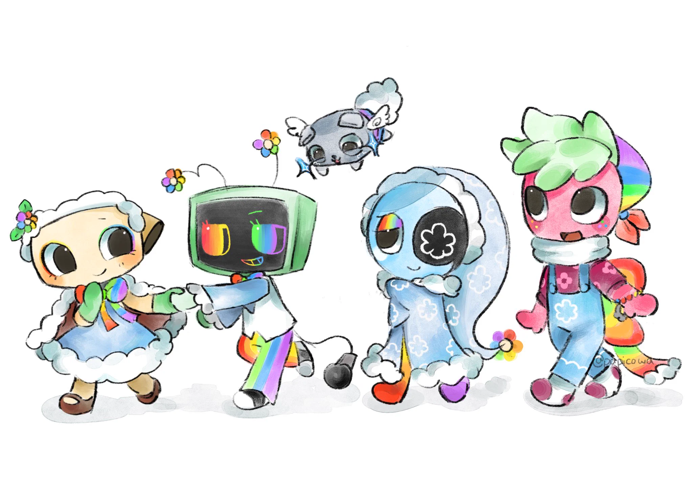

  

  

  

  &nbsp;&nbsp;Graphics Credits
 
${\textsf{\color{#FFEEEC} pixelsource, aretoilaisse, astrivsion, adequately, parapawzz, and digichu on tumblr}}$
${\textsf{\color{#FFEEEC} Papicowatin on X}}$
${\textsf{\color{#FFEEEC} JAYWALKER on tiktok!}}$

  

${\textsf{\color{#FF6663} 20 years old! Call me Isaac, Zoey, or Crystal!}}$

${\textsf{\color{#FEB144} She/her and he/him preferred!}}$

${\textsf{\color{#FDFD97} Birthday is February 3rd!}}$

${\textsf{\color{#9EE09E} Current hyperfixations are Dandys world and Genshin!}}$

${\textsf{\color{#9EC1CF} I currently also like Danganronpa, MM2, HSR, and ZZZ!}}$

${\textsf{\color{#CC99C9} As well as Mongil Stardive. VRCHAT, and Hi3rd!}}$

    
    
    

  

  

  

